# EVIDENCIAS DE LA PRÁCTICA 2.1 DAW

## Ciclo de vida de un contenedor

### Actividad 1.1: Explorar una imagen

Ejecutamos `docker search httpd` para localizar la imagen oficial en Docker Hub:

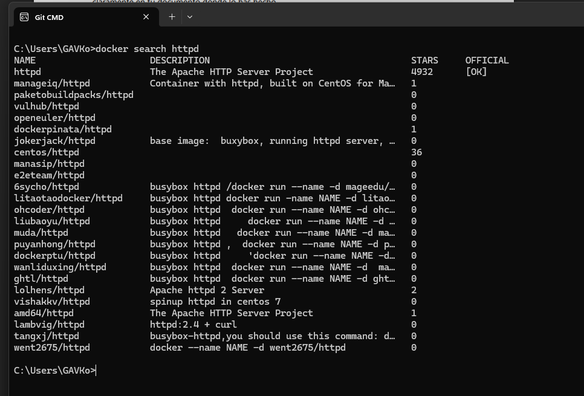

Descargamos y comparamos el tamaño de las dos imágenes (`httpd:2.4` y `httpd:2.4-alpine`). La variante Alpine es sustancialmente más ligera porque utiliza una distribución Linux minimalista basada en musl libc y BusyBox, optimizada para contenedores:

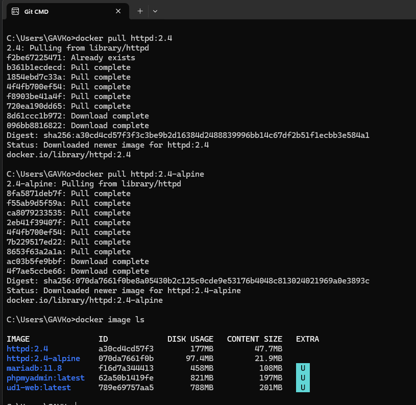

Inspeccionamos los metadatos de la imagen con `docker image inspect`:

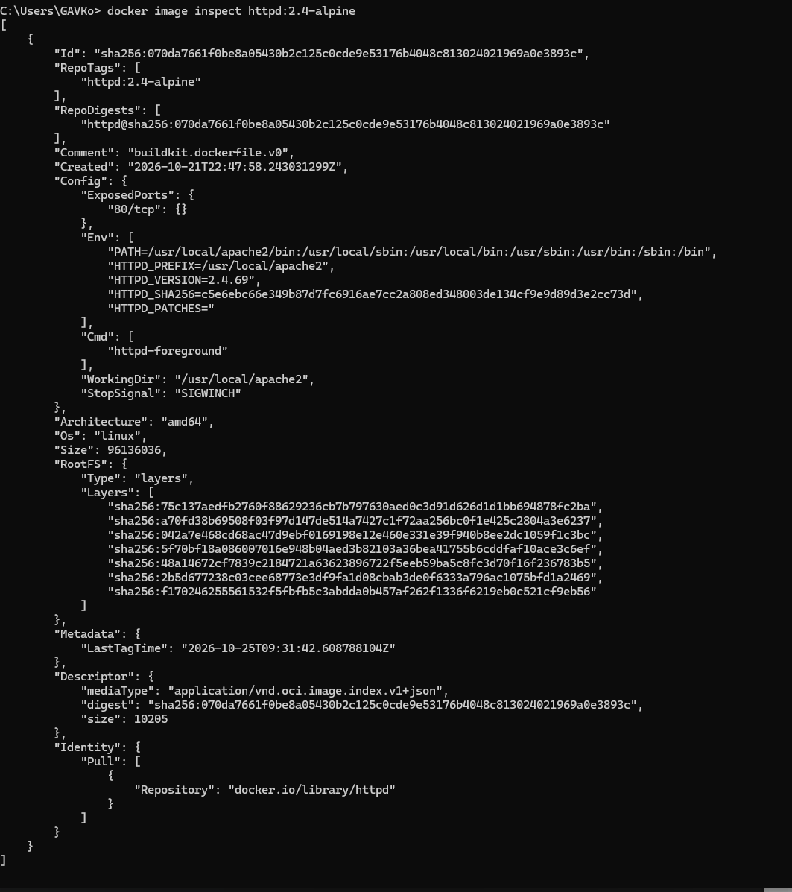

---

### Actividad 1.2: Ejecutar y comprobar un servidor web

Creamos y comprobamos el contenedor `apache-aula`:

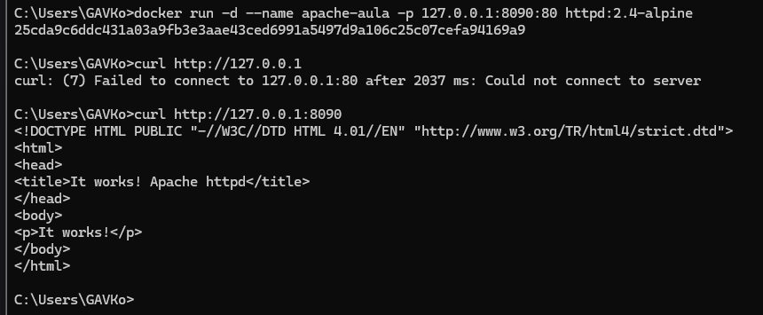

---

### Actividad 1.3: Seguir el ciclo de vida

Detenemos el contenedor y verificamos que `curl` falla con error de conexión, ya que el servicio no está en ejecución para recibir peticiones:

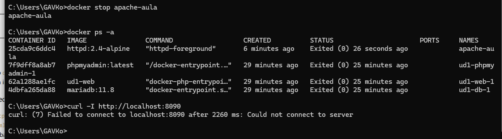

Al iniciarlo de nuevo con `docker start`, el contenedor pasa a estado `Up` y `curl` vuelve a responder correctamente:

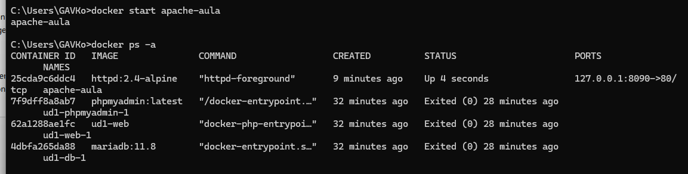
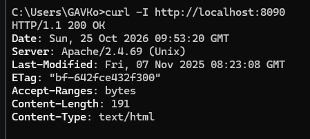

Al ejecutar `docker restart`, el contenedor reinicia su proceso principal manteniéndose accesible.

Al intentar borrar el contenedor con `docker rm apache-aula`, Docker rechaza la orden con error de seguridad porque está en ejecución (`Up`). Para forzar la detención y el borrado en un único comando se utiliza la opción `-f`:

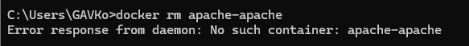

Al eliminar el contenedor, la imagen base (`httpd:2.4-alpine`) sigue existiendo en el host. Los contenedores y las imágenes son entidades independientes; borrar una instancia en ejecución no elimina la plantilla base de solo lectura:

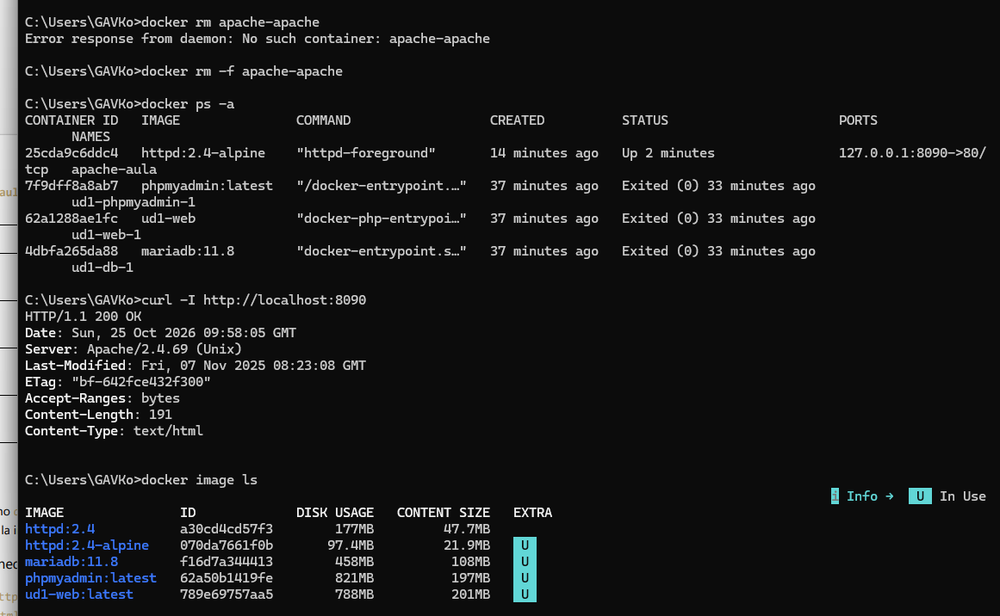

| Operación | Estado de apache-aula (STATUS) | ¿Responde curl? | ¿Sigue disponible httpd:2.4-alpine? |
| :--- | :--- | :--- | :--- |
| Antes de empezar | Up | Sí | Sí |
| `docker stop apache-aula` | Exited | No | Sí |
| `docker start apache-aula` | Up | Sí | Sí |
| `docker restart apache-aula` | Up | Sí | Sí |
| `docker rm apache-aula` | (Falla porque está Up) | Sí | Sí |
| `docker rm -f apache-aula` | (Desaparece del registro) | No | Sí |

---

### Actividad 1.4: Cambios dentro de un contenedor

Creamos el contenedor `apache-cambios` y añadimos el archivo `equipo.html`:

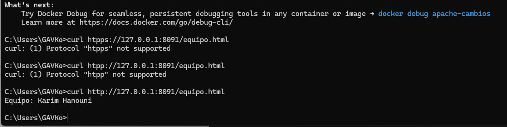

Con `docker diff` comprobamos las modificaciones introducidas en la capa de lectura y escritura (`A /usr/local/apache2/htdocs/equipo.html`):

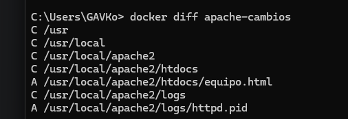

Al detener el contenedor, observamos que desaparece el archivo de PID del servidor web (`D /usr/local/apache2/logs/httpd.pid`):

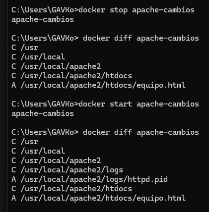

Al eliminar el contenedor (`docker rm -f`) y volver a levantarlo con la misma imagen, `equipo.html` desaparece arrojando un error 404 en `curl`, ya que la capa de escritura del contenedor anterior se destruyó junto con él:

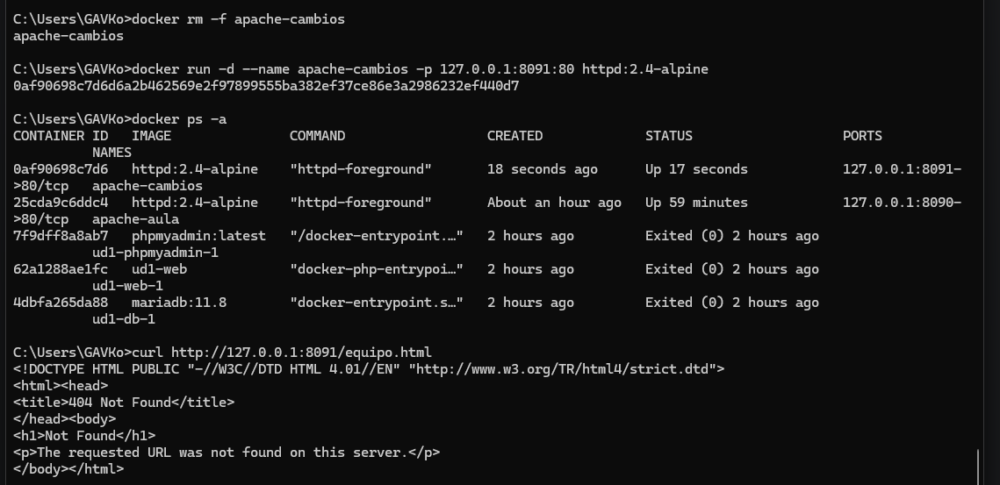

> [!IMPORTANT]
> **No es adecuado editar en marcha** porque los contenedores son efímeros e inmutables: cualquier modificación manual se destruye y se pierde en cuanto el contenedor se reinicia o se elimina (`docker rm`), rompiendo el control de versiones y la reproducibilidad del entorno. La **forma correcta** consiste en modificar el código en el host, compilar una nueva imagen con `docker build` y levantar un nuevo contenedor que reemplace al anterior (o, en desarrollo local, montar un volumen con `-v` para sincronizar los archivos sin alterar la imagen base).

---

### Actividad 1.5: Diagnosticar contenedores que se detienen

Lanzamos los tres contenedores de diagnóstico en segundo plano:

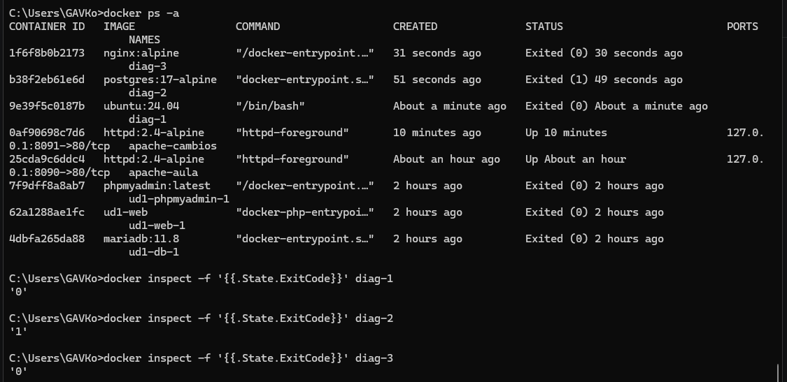

Consultamos los registros con `docker logs`:

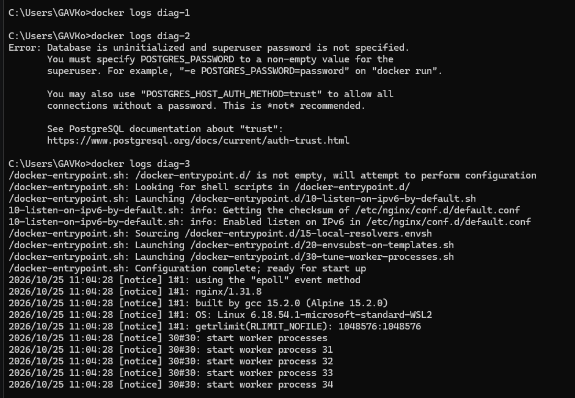

#### 1. Estado y códigos de salida

- **`diag-1`:** `ExitCode: 0` (Finalizado con éxito)
- **`diag-2`:** `ExitCode: 1` (Finalizado con error)
- **`diag-3`:** `ExitCode: 0` (Finalizado con éxito)

#### 2. Diagnóstico de detención

- **`diag-1` (`ubuntu:24.04`):**
    - **Causa:** Arranca por defecto una shell Bash en segundo plano (`-d`) sin terminal interactiva asociada (`-it`). Al no recibir ninguna entrada estándar (STDIN) ni script que ejecutar, Bash finaliza de inmediato con código `0`. Al terminar el proceso principal (PID 1), Docker detiene el contenedor.

- **`diag-2` (`postgres:17-alpine`):**
    - **Causa:** El registro indica que la base de datos no está inicializada y no se ha especificado la variable obligatoria `POSTGRES_PASSWORD`. Por política de seguridad, el script de entrada aborta la ejecución con código de error `1`.

- **`diag-3` (`nginx:alpine nginx -g "daemon on;"`):**
    - **Comparación:** El comando por defecto (`CMD`) de la imagen original es `["nginx", "-g", "daemon off;"]`, mientras que la orden ejecutada fuerza `daemon on;`.
    - **Efecto de `daemon on;` y por qué se apaga:** Esta opción indica a Nginx que se ejecute en segundo plano como un demonio tradicional de Linux. Al activarse, el proceso principal (PID 1) delega el servicio a procesos secundarios en segundo plano y finaliza su propia tarea con código `0`. Dado que Docker únicamente supervisa el PID 1, al terminar este considera que la tarea ha concluido y apaga el contenedor.

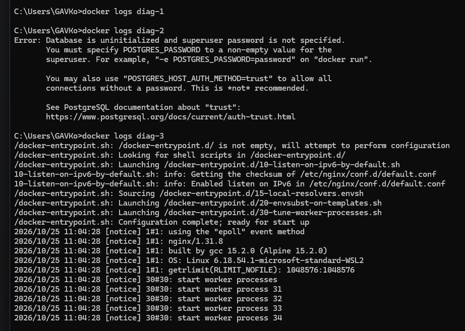
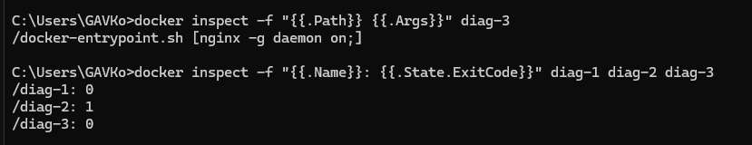

---

## Actividad 2.1: Construir imágenes paso a paso

### Parte A: Web estática con Apache

Creamos la carpeta `web-apache` con los archivos `index.html`, `estilos.css` y el archivo `Dockerfile`:

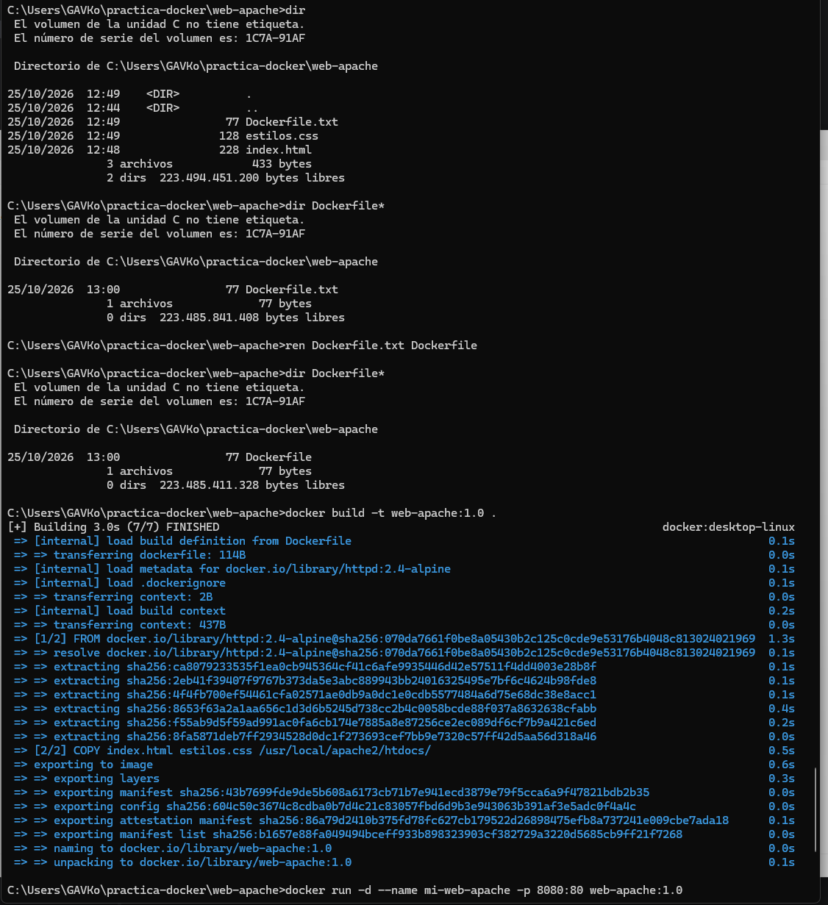

> **¿Por qué este Dockerfile no necesita CMD ni EXPOSE?**  
> Porque la imagen base `httpd:2.4-alpine` ya los define previamente (`CMD ["httpd-foreground"]` y `EXPOSE 80`)[cite: 7]. Al basarnos en ella mediante `FROM`, nuestro contenedor hereda ambas directivas automáticamente sin necesidad de reescribirlas.

---

### Parte B: La aplicación Node.js

Creamos la carpeta `saludo` junto a `package.json`, `app.js` y el `Dockerfile`[cite: 9]. Construimos la imagen y arrancamos el contenedor `app-saludo`:

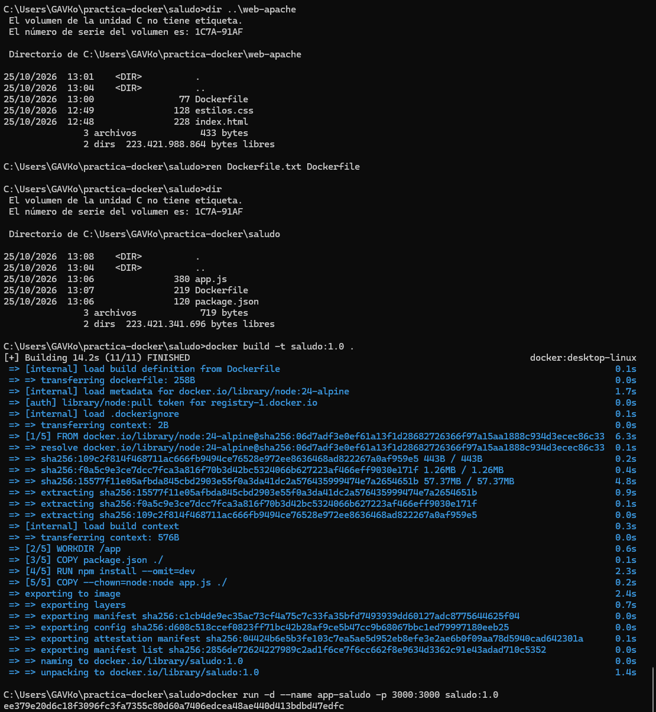

Comprobamos que las rutas responden adecuadamente mediante `curl`:

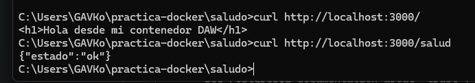

Verificamos que la aplicación corre sin privilegios (`node`) y dentro del directorio `/app`:

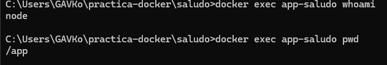

Lanzamos un segundo contenedor (`app-saludo-2`) modificando las variables de entorno `PUERTO` y `MENSAJE` mediante el parámetro `-e`:

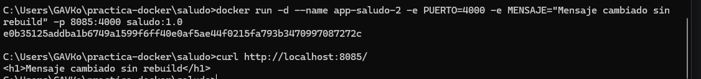

> **¿Qué tienes que cambiar también en la opción -p y por qué?**  
> Es obligatorio cambiar el puerto del lado derecho de `-p` (`:4000`) para que coincida con el nuevo valor de `PUERTO` en el que escucha Express. Si mantuviéramos `:3000`, las peticiones llegarían a un puerto donde la aplicación no atiende. Además, se modifica el puerto del host (`8085`) para no colisionar con el contenedor anterior.

---

## Actividad 2.2: Publicar y versionar una imagen

### 1. Publicación de la imagen 1.0 en Docker Hub

Etiquetamos la imagen con nuestro usuario (`karimblackstar/saludo:1.0`), la subimos al registro con `docker push` y eliminamos los contenedores e imágenes locales con `docker rm -f` y `docker rmi` para preparar la prueba remota:

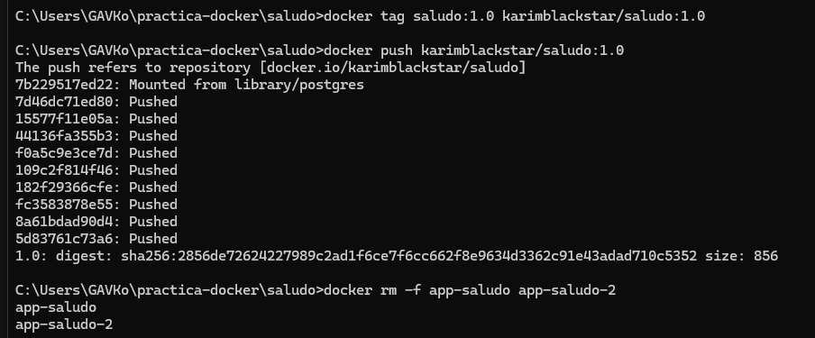
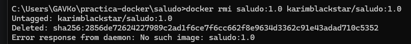

* **Capas subidas vs reutilizadas:** La capa marcada como `Mounted from...` ya existía en el registro remoto (pertenece a la imagen base oficial) y se reutiliza para evitar transferencias redundantes; las capas marcadas como `Pushed` son las capas nuevas generadas durante la compilación.

---

### 2. Comprobación desde Docker Hub

Ejecutamos el contenedor a partir de la imagen remota (`karimblackstar/saludo:1.0`), verificando que Docker descarga las capas del registro y que el servicio responde mediante `curl`:

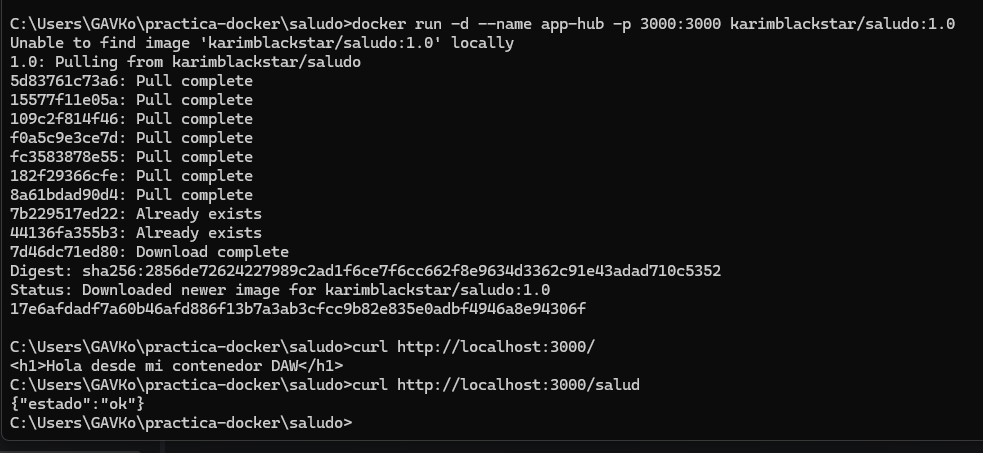

---

### 3. Versionado con versión 1.1 y etiqueta latest

Modificamos la variable `MENSAJE` en el `Dockerfile` y compilamos la nueva versión asignando las etiquetas `1.1` y `latest`:

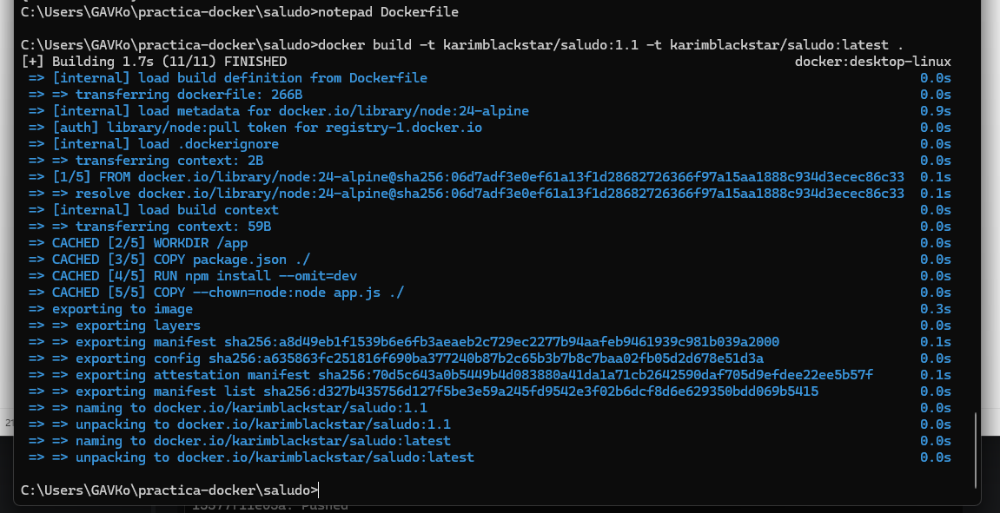

Publicamos ambas etiquetas en Docker Hub mediante `docker push`:

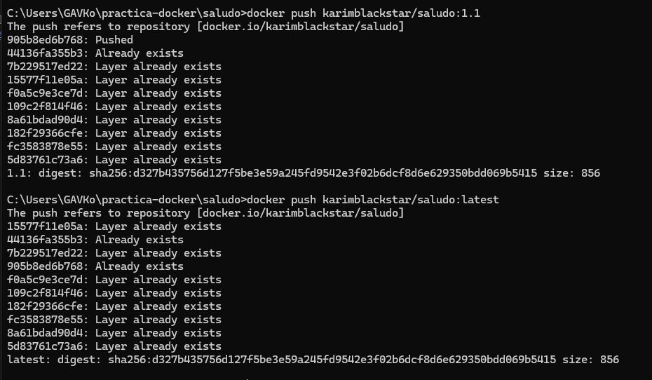

---

### 4. Verificación de etiquetas y arquitectura en Docker Hub

Accedemos a Docker Hub y verificamos en la pestaña **Tags** las versiones publicadas (`1.0`, `1.1` y `latest`) junto con su arquitectura (`linux/amd64`):

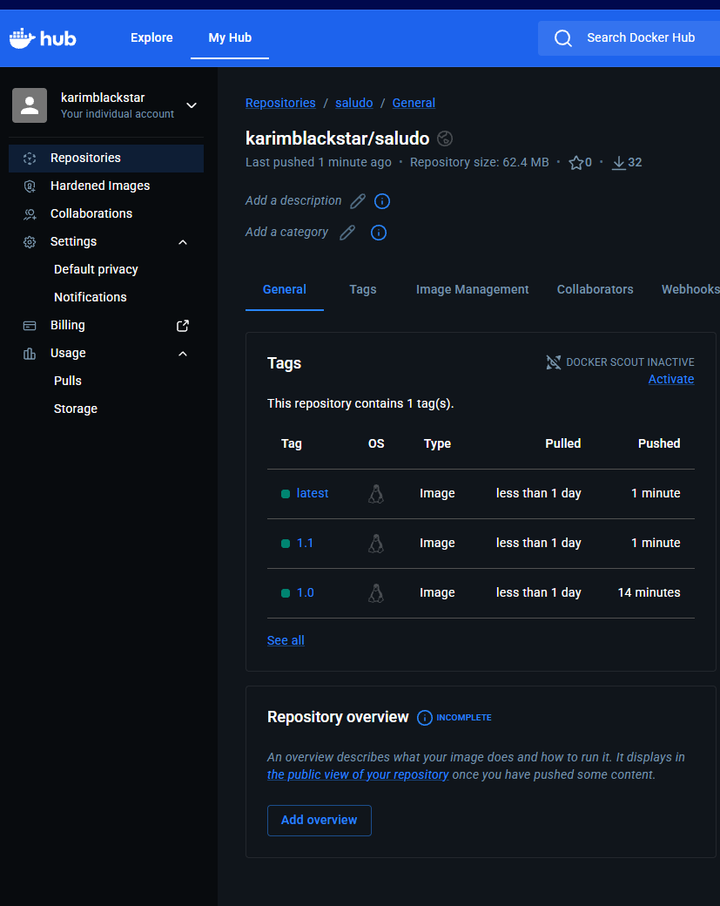
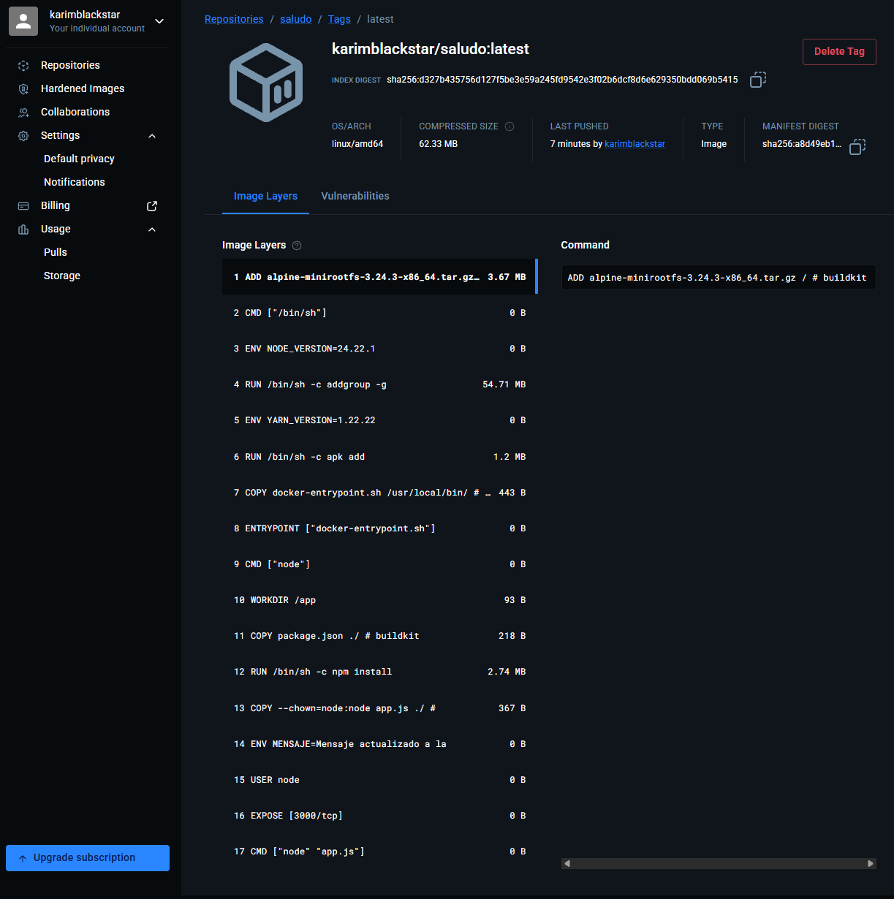